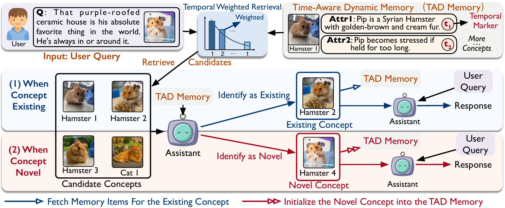

# TAME-O

This repo provides the official implementation of **TAME-O**:

<div align="center">
<H2>TAMEing the Open-World Personalization:<br>Towards Open-Set Personalized MLLM Assistant<br>(NeurIPS 2026)</H2>
</div>

# Overview

<div align="center">
<H2>
🔥 TAME-O: An open-set, long-context personalized MLLM assistant.</H2>
</div>



<div align="center">
<H4>
Paradigm of TAME-O. The Concept Reconciliation (CR) skill retrieves candidate concepts from the Time-Aware Dynamic (TAD) Memory with temporal weighting, and the MLLM decides whether the referenced concept is existing or novel.
</H4>
</div>

# 🛠️ Environment Setup

The environment is managed with [uv](https://docs.astral.sh/uv/) (Python 3.14). A prebuilt `flash-attn` wheel for **torch 2.11 / CUDA 13.0 / cp314 / linux-x86_64** is pinned in `pyproject.toml`, so no compilation is needed.

```sh
# install uv (skip if already installed)
curl -LsSf https://astral.sh/uv/install.sh | sh

# create the venv and install all dependencies (incl. flash-attn)
uv sync
```

The backbone [Qwen/Qwen3.5-9B](https://huggingface.co/Qwen/Qwen3.5-9B) and the retrieval embedder [Qwen/Qwen3-VL-Embedding-2B](https://huggingface.co/Qwen/Qwen3-VL-Embedding-2B) are downloaded from Hugging Face on the first run.

# 🏗️ Benchmarks

- **LCMP-H**: obtain the LCMP benchmark from [TAME](https://github.com/ronpay/TAME) (*TAMEing Long Contexts in Personalization: Towards Training-Free and State-Aware MLLM Personalized Assistant*). Only the hard questions (`hard_question.yaml`) are used.
- **LCMP-O**: the open-set LCMP benchmark, included in `data/LCMP-O`.

Place LCMP under `data/`:

```sh
data
├── LCMP      # concept_person, concept_pet, concept_obj
└── LCMP-O    # concept_person, concept_pet, concept_object
```

# 🚀 TAME-O

TAME-O identifies whether each dialogue refers to an existing or a novel personalized concept, so the assistant personalizes without a predefined concept set.

## Run TAME-O

```sh
# run TAME-O on open-set LCMP-H with Qwen3.5-9B
uv run python -m core.main --model qwen --dataset LCMP-H
# run TAME-O on LCMP-O with Qwen3.5-9B
uv run python -m core.main --model qwen --dataset LCMP-O
# run the TAME ablation on open-set LCMP-H with Qwen3.5-9B
uv run python -m core.main --model qwen --ablation TAME --dataset LCMP-H
```

Answers are written to `results/<dataset>/<run_name>.jsonl`. Run `uv run python -m core.main --help` for the hyperparameters (K, R, λ, T, L, τ).

## ✅ Evaluation

```sh
# run evaluation on generated answers
uv run python -m eval.evaluator $input_file $output_file --dataset LCMP-H
```

# 📚 Project Structure

- `core/`: TAME-O pipeline
  - `main.py`: run script
  - `TAMEo.py`: TAME-O framework
  - `utils/`: open-set identification, concept fission mitigation, retrieval, and model wrappers
- `eval/`: evaluation scripts
- `data/`: benchmark concepts
- `assets/`: figures

# 📖 Citation

If you find TAME-O useful, please cite:

```bibtex
@inproceedings{hong2026tameo,
	author = {Hong, Rongpei and Lang, Jian and Zhong, Ting and Zhou, Fan},
	booktitle = {Advances in Neural Information Processing Systems (NeurIPS)},
	year = {2026},
	title = {TAMEing the Open-World Personalization: Towards Open-Set Personalized MLLM Assistant},
}
```

If you use the LCMP benchmark or TAME, please also cite:

```bibtex
@inproceedings{hong2026tameing,
	author = {Hong, Rongpei and Lang, Jian and  Zhong, Ting and Wang, Yong and Zhou, Fan},
	booktitle = {ACM SIGKDD Conference on Knowledge Discovery and Data Mining (KDD)},
	year = {2026},
	title = {TAMEing Long Contexts in Personalization: Towards Training-Free and State-Aware MLLM Personalized Assistant},
}
```
